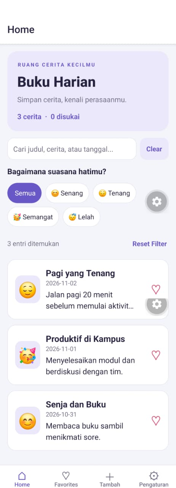
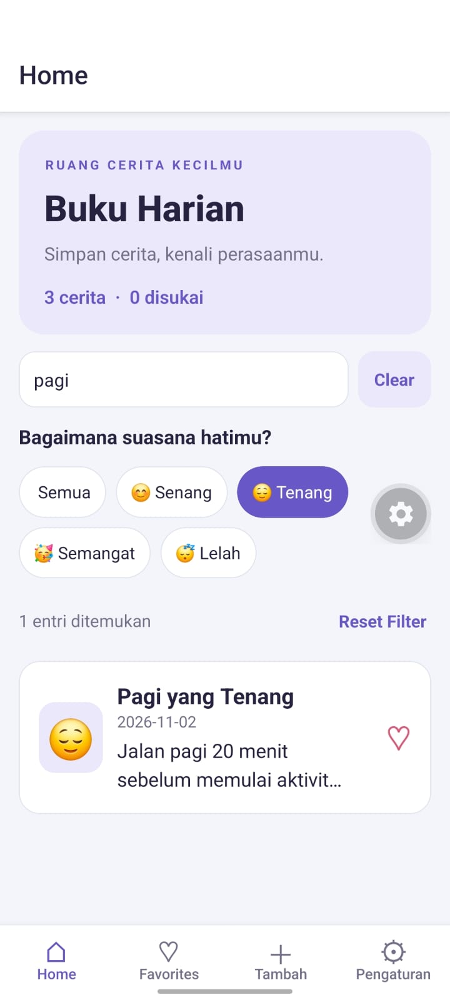
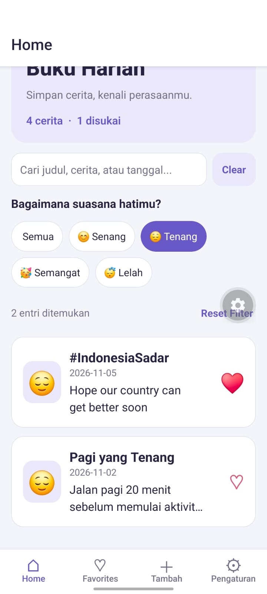
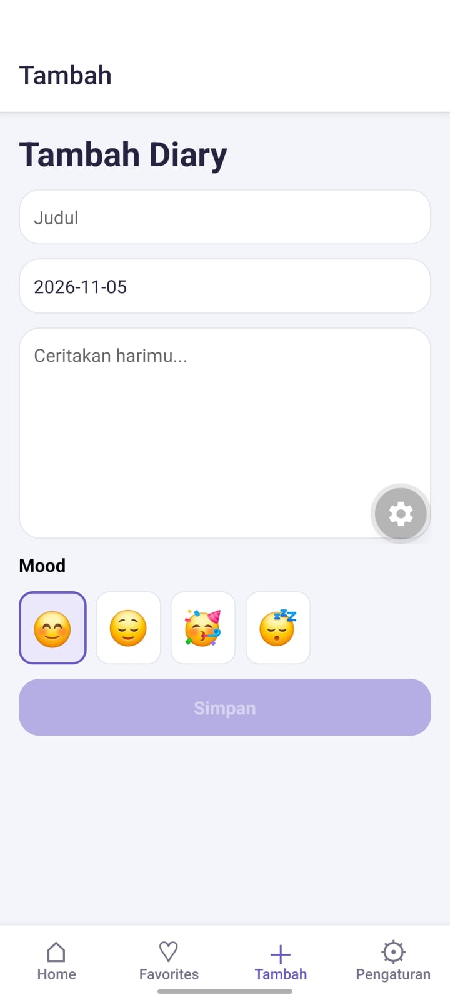
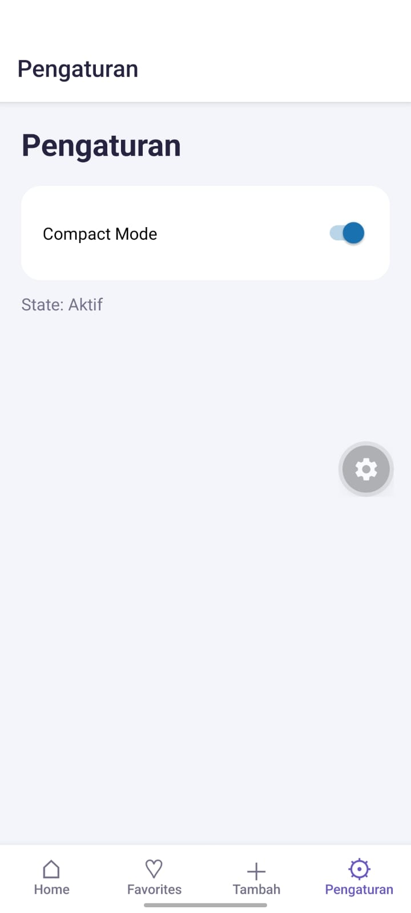
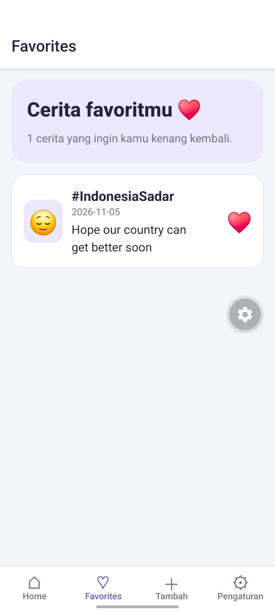

# Praktikum 6 — Diary App dengan React Hooks

**Nama**: Fadhla Rahayu Alfairuz  
**NIM**: 2430511007  
**Mata kuliah**: Pemrograman Mobile Multiplatform

Diary App adalah aplikasi buku harian dengan React Native dan Expo Router. Pengguna dapat menulis diary, mencari dan menyaring entri berdasarkan mood, serta menyimpan entri yang disukai di tab Favorites.

## Cara menjalankan

Buka terminal di folder proyek yang berisi `package.json`. Di Windows PowerShell, jalankan:

```powershell
npm.cmd ci
npx.cmd expo start -c
```

Di macOS atau Linux, gunakan `npm ci` lalu `npx expo start -c`. Setelah server Expo berjalan, tekan **w** untuk membuka aplikasi di browser atau buka proyek dengan Expo Go yang mendukung SDK proyek.

## Fitur yang dikerjakan

| Fitur               | Cara kerja                                                                                                                                                                                                  |
| ------------------- | ----------------------------------------------------------------------------------------------------------------------------------------------------------------------------------------------------------- |
| Filter Mood di Home | `useState` menyimpan mood yang dipilih. Opsi **Semua** menampilkan entri dari semua mood yang cocok dengan pencarian.                                                                                       |
| Pencarian gabungan  | `useDiarySearch(entries, mood)` menggunakan `useMemo` untuk mengambil entri yang cocok dengan kata pencarian **dan** mood. Kata pencarian diperiksa pada judul, ringkasan, dan tanggal setelah jeda 350 ms. |
| Custom hook favorit | `useLikedEntries(entries, likedIds)` menerima daftar diary dan kumpulan ID yang disukai, lalu mengembalikan daftar entri favorit.                                                                           |
| Tab Favorites       | Menampilkan hasil `useLikedEntries`. Setiap kartu dapat dibuka ke Detail atau dilepas dari favorit dengan menekan ikon hati.                                                                                |
| Sinkronisasi Like   | Home, Detail, dan Favorites membaca `likedIds` dari `DiaryProvider` yang sama. Saat ikon hati ditekan, `toggleLike` membuat Set baru dengan ID yang sudah ditambah atau dihapus.                            |
| Reset Filter        | Mengosongkan input dan nilai pencarian setelah debounce, memilih **Semua**, lalu mengembalikan fokus ke kolom pencarian. **Clear** mengosongkan pencarian saja.                                             |
| Perbaikan Styles    | Palet ungu, jarak antarkartu, tombol mood dengan penanda aktif, dan pesan ketika daftar kosong membantu pengguna membaca dan menavigasi aplikasi.                                                           |

## Penjelasan React Hooks

| Hook dan lokasi                 | Input                                                              | Output                                                                                     | Dependency                                                                      | Alasan pemilihan                                                                                                                |
| ------------------------------- | ------------------------------------------------------------------ | ------------------------------------------------------------------------------------------ | ------------------------------------------------------------------------------- | ------------------------------------------------------------------------------------------------------------------------------- |
| `useState` di Home              | String kosong sebagai mood awal                                    | `mood` dan `setMood`                                                                       | —                                                                               | Menyimpan mood pilihan pengguna dan memperbarui Home saat pilihan berubah.                                                      |
| `useEffect` di `useDiarySearch` | Fungsi yang menjadwalkan pembaruan `debouncedQuery` setelah 350 ms | Hook mengembalikan `undefined`. Fungsi efek mengembalikan cleanup untuk membatalkan timer. | `[query]`                                                                       | Menjalankan pencarian setelah pengguna berhenti mengetik dan membatalkan timer lama ketika query berubah atau komponen dilepas. |
| `useMemo` di `useDiarySearch`   | Fungsi penyaringan berdasarkan pencarian dan mood                  | `filteredEntries`                                                                          | `[entries, debouncedQuery, mood]`                                               | Menggunakan kembali hasil filter selama data dan kriterianya sama.                                                              |
| `useMemo` di `useLikedEntries`  | Fungsi yang memeriksa apakah ID tiap entri ada di `likedIds`       | Daftar entri favorit                                                                       | `[entries, likedIds]`                                                           | Menghitung daftar favorit dari daftar diary dan status Like yang sudah tersedia.                                                |
| `useCallback` di Home           | Fungsi membuka Detail, mengosongkan pencarian, atau mereset filter | Referensi fungsi untuk aksi pengguna                                                       | Buka Detail memakai `[router]`. Clear dan Reset Filter memakai `[resetSearch]`. | Mempertahankan referensi fungsi selama dependencynya sama.                                                                      |
| `useRef` di Home                | `null` sebagai nilai awal                                          | `searchRef` yang terhubung ke `TextInput`                                                  | —                                                                               | Memungkinkan Clear dan Reset Filter memanggil `focus()` pada kolom pencarian.                                                   |
| `useContext` di `useDiary`      | `DiaryContext`                                                     | Data dan aksi dari `DiaryProvider`, termasuk `entries`, `likedIds`, dan `toggleLike`       | —                                                                               | Membagikan satu sumber status Like ke Home, Detail, dan Favorites.                                                              |

## Screenshot hasil aplikasi

Simpan enam screenshot di folder `screenshots/` pada tingkat yang sama dengan README. Gunakan nama file di bawah agar gambar muncul otomatis di GitHub.

### 1. Home

Daftar diary dan pilihan filter mood.



### 2. Search

Contoh pengujian dengan mood **Tenang** dan pencarian `pagi`. Hasil harus memenuhi kedua kriteria.



### 3. Detail

Isi diary dan status **Disukai** setelah ikon hati ditekan.



### 4. Create

Form untuk mengisi judul, tanggal, isi diary, dan memilih mood.



### 5. Settings

Status Compact Mode setelah switch diaktifkan.



### 6. Favorites

Daftar diary yang diberi Like. Saat Like dilepas di tab ini, entri keluar dari Favorites dan ikon hati pada Home dan Detail ikut berubah.


